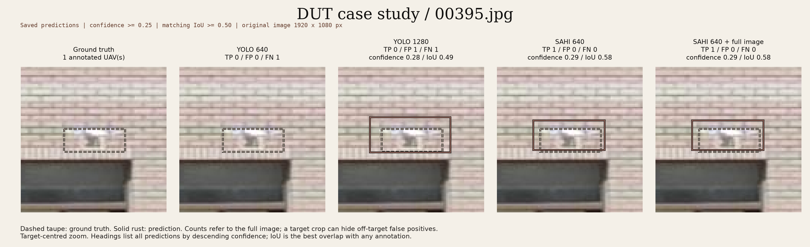

# Perception Under Uncertainty: From raw pixels to real world

I'm exploring what happens when computer vision models encounter conditions
that make their predictions less reliable: small objects, moving cameras and
sensors that disagree.

Through practical experiments, I'm testing what these models can detect, where
they struggle, and what that means for systems built on their predictions.
I'll share the code, results and things that go wrong along the way.

## Post 1: Small objects and observability

Can preserving more image detail make distant drones easier to detect?

I compared whole-image YOLO at two resolutions with SAHI, which analyses
smaller, overlapping sections of an image.

Across 300 new DUT Anti-UAV images, increasing YOLO's resolution recovered more
drones, including at similar false-positive counts. Slicing helped in some
cases, but produced more inaccurate boxes and extra detections, while taking
substantially longer.

[Read the experiment and findings](docs/post1_independent_evaluation.md) ·
[Explore the results and visual examples](runs/dut_300_evaluation/README.md)



*One case where slicing helped: a closer-fitting box around a tiny drone.
DUT Anti-UAV, image 00395. The write-up also follows the cases where it failed.*

## The research

The series covers small objects, motion cues, monocular geometry, RGB/thermal
fusion, detection calibration and tracking. Calibration is the central question
for me: how much should I trust a detection when the image conditions change?

See the [experiment plan](docs/experiment_plan.md) for the questions and papers,
and the [data notes](data/README.md) for the datasets I'm using or planning to try.

## Try the setup

The project uses **Python 3.12.13 and uv 0.12.19**. With
[uv installed](https://docs.astral.sh/uv/getting-started/installation/), run these
commands from the project folder:

```bash
uv sync --locked
uv run --locked ppu run --config configs/smoke.json
```

This creates the local `.venv` and runs a setup check.
In VS Code, select `.venv/bin/python` as the interpreter.

Each run saves its settings, environment details and available source information
in a new folder. The command prints the path:

```text
artifacts/smoke/<run-id>/run_manifest.json
```

[`configs/smoke.json`](configs/smoke.json) contains the configuration version,
experiment name, seed and output directory. Relative paths start at the working
directory. Use `--output-dir` to choose a different output root, or
`uv run --locked ppu run --help` for help.

I also use Docker to check the code and saved-result analysis in Linux.
Post 1's model evaluation and timings were collected natively on macOS.

## Finding your way around

- [`docs/`](docs/) — experiment write-ups, methodology and exploratory notes.
- [`scripts/`](scripts/) — evaluation, analysis and visualisation tools. Start
  with [`analyse_post1.py`](scripts/analyse_post1.py) to inspect saved predictions.
- [`results/post1/`](results/post1/) and [`runs/dut_300_evaluation/`](runs/dut_300_evaluation/)
  — the original exploration and the 300-image evidence, including CSV tables
  and figures. Selected results are tracked in Git. Other run outputs stay local.
- [`src/`](src/), [`configs/`](configs/) and [`tests/`](tests/) — the package,
  experiment settings and automated checks.

## Development checks

```bash
uv run --locked ruff format --check .
uv run --locked ruff check .
uv run --locked pytest
```

[CI](.github/workflows/ci.yml) also checks the installed package and container.
To update a dependency, use `uv lock --upgrade-package <package>`, run
`uv sync --locked`, and repeat the checks.

Questions and suggestions are welcome as the experiments take shape.
The code is available under the [MIT license](LICENSE).
