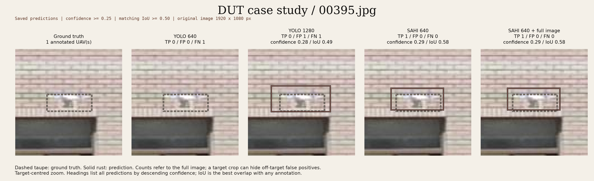
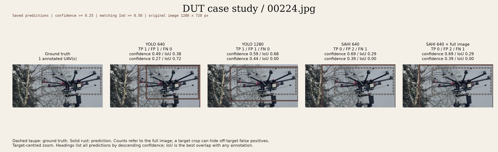
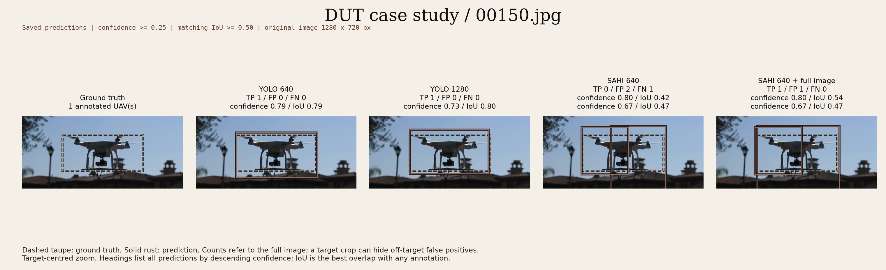

# Post 1: More pixels, more drones?

A drone can be easy to spot in a photograph, then become a few indistinct pixels when that photograph is shrunk for a detector.

That was where I started. Before trying a different model, could I get more out of the one I had by throwing away less detail?

I tried giving it a larger whole image, then smaller patches of the original. The larger image helped. Slicing also found drones the whole-image runs missed, but brought less accurate boxes, extra detections and a much longer processing time.

The [saved results](../runs/dut_300_evaluation/README.md) contain the measurements and visual cases behind this post.

## What I tried

I used the pretrained [TomSmail/drone-yolo-v1 detector](https://huggingface.co/TomSmail/drone-yolo-v1) throughout, without further training. The images came from DUT Anti-UAV, introduced by [Zhao et al. (2022)](https://arxiv.org/abs/2205.10851), with labelled drone boxes to check predictions against.

| Method | What it does |
|---|---|
| YOLO 640 | Looks at the whole image, resized to fit within 640 × 640. |
| YOLO 1280 | Does the same at 1280 × 1280, keeping more detail. |
| SAHI 640 | Looks through overlapping 640 × 640 patches, then combines the predictions. |
| SAHI 640 + full image | Uses the patches and a whole-image prediction at 640, then combines them. |

SAHI comes from [Akyon, Altinuc and Temizel (2022)](https://doi.org/10.1109/ICIP46576.2022.9897990). Slicing lets small objects occupy more of each detector input instead of shrinking the entire scene at once. Their paper reports improvements on aerial-image datasets. Would that help this drone detector too?

My [first 30 images](post1_sahi_full_image.md) suggested that larger inputs recovered missed drones, while slicing produced many extra boxes. To check beyond those examples, I fixed a random sample of **300 images containing 309 labelled drones**, excluding the original images and their exact copies. I chose the sample and settings before running predictions. The [image list](../results/post1/evaluation_sample_300.txt) and [selection record](../configs/dut_independent_eval.json) are saved.

Here's how I counted the results:

- **Confidence** is the detector's score for a prediction. I kept boxes scoring at least 0.25, then checked five higher cutoffs chosen in advance.
- **IoU** measures box overlap: 0 means none, 1 means an exact fit. A prediction counted as a match at 0.5 or above, with each labelled drone matched only once.
- **Recall** is the percentage of labelled drones matched. **False positives** are all unmatched predictions, including poorly placed boxes and duplicates. A box can count as a false positive even if it contains part of a real drone.

## 1. Did a larger whole image help?

Yes. At confidence 0.25, YOLO 1280 matched 27 more drones than YOLO 640, raising recall from **70.2% to 79.0%**. False positives also rose, from **66 to 133**.

| Method | Matched drones | Missed drones | Recall | False positives | Typical time per image |
|---|---:|---:|---:|---:|---:|
| YOLO 640 | 217 | 92 | 70.2% | 66 | 94 ms |
| YOLO 1280 | 244 | 65 | 79.0% | 133 | 262 ms |
| SAHI 640 | 201 | 108 | 65.0% | 330 | 1,226 ms |
| SAHI 640 + full image | 206 | 103 | 66.7% | 357 | 1,338 ms |

Source: [summary.csv](../runs/dut_300_evaluation/summary.csv). Confidence ≥ 0.25, IoU ≥ 0.5. Typical time is the median on my CPU, with the timing boundaries explained below.

Was the larger input genuinely useful, or was it just drawing more boxes and getting more right along the way?

### What if I allow roughly the same number of false positives?

YOLO 1280 at confidence **0.45** matched **227 drones with 44 false positives**. YOLO 640 at **0.35** matched **210 with 42 false positives**.

That's 17 more correct matches at almost the same false-positive count. In the runs timed at confidence 0.25, the larger input took about 2.8 times as long.

I didn't want to select only a favourable cutoff. Here is the complete comparison, with each cell showing **matched drones / false positives** across the same 300 images, at IoU ≥ 0.5.

| Confidence ≥ | YOLO 640 | YOLO 1280 | SAHI 640 | SAHI 640 + full image |
|---|---:|---:|---:|---:|
| 0.25 | 217 / 66 | 244 / 133 | 201 / 330 | 206 / 357 |
| 0.35 | 210 / 42 | 237 / 79 | 192 / 213 | 198 / 232 |
| 0.45 | 194 / 30 | 227 / 44 | 188 / 140 | 191 / 155 |
| 0.55 | 182 / 14 | 207 / 24 | 177 / 95 | 181 / 103 |
| 0.70 | 124 / 4 | 151 / 6 | 128 / 35 | 133 / 43 |
| 0.80 | 64 / 2 | 43 / 0 | 54 / 2 | 80 / 15 |

Source: [confidence_sweep.csv](../runs/dut_300_evaluation/confidence_sweep.csv). Higher cutoffs filter the saved predictions; they don't rerun the detector or combine boxes again.

YOLO 1280 didn't retain more matches at every cutoff. At 0.80, YOLO 640 kept more, while 1280 had no false positives. A higher cutoff removes real detections too.

For every tested SAHI cutoff, one of the YOLO settings kept more matches with no more false positives, sometimes at a different cutoff. At 0.80, for example, sliced-only SAHI kept 54 matches and two false positives; YOLO 640 kept 64 and two. So what was holding slicing back?

## 2. Slicing helped some targets, but struggled with box placement

At confidence 0.25, sliced-only SAHI recovered **30 drones that YOLO 640 missed**, but lost **46 that YOLO 640 matched**. That tells me more than its lower overall recall: the methods weren't simply finding fewer or more of the same drones.

These target-level comparisons come from [predictions.json](../runs/dut_300_evaluation/predictions.json), using the [analysis script](../scripts/analyse_post1.py).

### Where slicing helped: 00395



The drone is a small, blurry shape against a brick wall. YOLO 640 produces no box. YOLO 1280 puts one around it, but its IoU of **0.49** falls just below the matching rule. Both SAHI variants reach **0.58** and count as a match.

Slicing helped here. But “YOLO 1280 missed it” would hide how close its box was.

### Did the smallest drones benefit overall?

I grouped drones by their approximate size after scaling the whole image to 640, using the same objects in each group for every method.

| Approximate size at 640 | Number of drones | YOLO 640 recall | YOLO 1280 recall | SAHI 640 recall | SAHI + full image recall |
|---|---:|---:|---:|---:|---:|
| Under 16 pixels | 131 | 50.4% | 59.5% | 45.0% | 48.9% |
| 16 to under 32 pixels | 55 | 72.7% | 96.4% | 90.9% | 83.6% |
| 32 to under 64 pixels | 52 | 80.8% | 86.5% | 73.1% | 75.0% |
| 64 pixels or more | 71 | 97.2% | 95.8% | 76.1% | 80.3% |

Source: the size analysis in [analyse_post1.py](../scripts/analyse_post1.py), at confidence 0.25 and IoU 0.5. Size is the square root of the labelled box area after scaling, rather than its width alone.

Slicing did well in the 16 to under 32 pixel group, but worse than both whole-image methods in the smallest group. YOLO 1280 improved on 640 in all three groups below 64 pixels. Preserving detail helped, but slicing didn't deliver that benefit consistently.

### How closely did the boxes fit?

I tried looser and tighter overlap rules on exactly the same predictions:

| Method | Recall at IoU 0.3: looser fit | Recall at IoU 0.5 | Recall at IoU 0.75: tighter fit |
|---|---:|---:|---:|
| YOLO 640 | 74.1% | 70.2% | 38.5% |
| YOLO 1280 | 82.8% | 79.0% | 30.1% |
| SAHI 640 | 84.8% | 65.0% | 11.0% |
| SAHI 640 + full image | 85.1% | 66.7% | 12.0% |

Source: the IoU sensitivity analysis in [analyse_post1.py](../scripts/analyse_post1.py), using the saved predictions at confidence 0.25.

With the loose rule, SAHI matched slightly more drones than YOLO 1280. But sliced-only SAHI's recall fell from **84.8% to 65.0%** at IoU 0.5, and to **11.0%** at 0.75. Inaccurate box placement was a substantial problem.

Even at IoU 0.3, sliced-only SAHI had **269 unmatched predictions**, against **121** for YOLO 1280. Accepting looser boxes didn't resolve the extra detections. And at the tightest rule, YOLO 640 outperformed 1280: more matches at IoU 0.5 didn't guarantee more tightly fitted boxes.

### Where the box mattered: 00224



This drone is large and visible. Both YOLO methods have a matching box. Both SAHI variants draw a much taller box, including hanging equipment below the annotated drone, with a best IoU of **0.29**.

The prediction is around the right subject, but doesn't fit the labelled extent. The image shows the mismatch, without telling me which internal step caused it.

[Bolya et al.'s TIDE paper (2020)](https://arxiv.org/abs/2008.08115) helped me think about these different errors. I borrowed its overlap-based grouping idea for a simple breakdown, rather than running the full TIDE analysis:

| Method | Duplicate boxes | Partial overlap | Little or no overlap |
|---|---:|---:|---:|
| YOLO 640 | 2 | 20 | 44 |
| YOLO 1280 | 9 | 16 | 108 |
| SAHI 640 | 5 | 80 | 245 |
| SAHI 640 + full image | 11 | 78 | 268 |

Source: [analyse_post1.py](../scripts/analyse_post1.py), at confidence 0.25. Partial overlap means best IoU from 0.1 to below 0.5; little or no overlap means below 0.1. These suggest localisation and background errors, rather than proving their causes.

The supporting [full-scene view of 00787](../runs/dut_300_evaluation/visuals/00787_comparison.png) shows boxes around tree branches, away from the drone. This wasn't exclusive to SAHI: YOLO 640 gave one of those boxes confidence **0.87**.

## 3. Did adding the whole image help SAHI?

I hoped a whole-image view would complement the patches, particularly for larger drones. It helped in some cases.

### A recovered match: 00150



Sliced-only SAHI draws two boxes with overlap scores of **0.42 and 0.47**. With full-image prediction enabled, one final box reaches **0.54**. The drone now counts as matched, though an extra box remains. Both YOLO methods already matched it, at about **0.79 and 0.80**.

Across the sample, adding full-image prediction gained **11 matches and lost six**, a net gain of five. Matches rose from **201 to 206**, while false positives rose from **330 to 357** ([summary](../runs/dut_300_evaluation/summary.csv); [target-level analysis](../scripts/analyse_post1.py)).

Combining whole-image and sliced predictions can change existing boxes too. In [00622](../runs/dut_300_evaluation/visuals/00622_comparison.png), a box remains around the drone, but its overlap falls from **0.54 to 0.46**, turning a match into a miss. The saved final boxes show the change, but don't establish exactly how the intermediate predictions were combined.

### Was it worth the extra time?

Sliced-only SAHI took **1,226 ms per image**, about **13 times as long as YOLO 640** and **4.7 times as long as YOLO 1280**. Adding the whole-image pass took that to **1,338 ms**.

Those are the median times in [summary.csv](../runs/dut_300_evaluation/summary.csv); the [individual timings](../runs/dut_300_evaluation/latencies.csv) and [measurement details](post1_sahi_methodology.md#timing-and-reproducibility) are available too.

For that extra work, neither SAHI variant offered a better match/false-positive trade-off than the available YOLO settings in the complete confidence comparison above.

## What I'm taking from this

Increasing whole-image resolution was a more useful way to spend extra processing time on recovering drones in this experiment. YOLO 640 was still the faster option. Slicing produced individual successes, but its box-placement problems and extra detections outweighed them overall. Adding a whole-image pass helped some cases without changing that result.

The larger sample showed the same main patterns as the initial exploration. Preserving pixels helped, but finding something near a drone and placing an accurate box around it were different achievements. Looking at the boxes made that clearer than the totals alone.

## What this comparison covers

All 300 images contain a labelled UAV, so this doesn't establish how reliably the detector avoids false alarms in drone-free scenes. Exact copies were excluded, but similar scenes may remain. I also can't determine whether any images appeared in the pretrained model's training data.

Timings are from my Intel Core i5 CPU, one image at a time. They include preparation, slicing, prediction and box combining, but exclude image reading/decoding, model loading and saving results.

The [methodology notes](post1_sahi_methodology.md#the-300-image-evaluation) hold the selection audit, settings and timing procedure. The [run manifest](../runs/dut_300_evaluation/run_manifest.json) records the model identity, source revision and environment.

## Look at the evidence

The [results guide](../runs/dut_300_evaluation/README.md) links all five run files and visual cases, with commands for repeating the analysis. The [experiment plan](experiment_plan.md) explains where Post 1 fits into the series.

The counts, size groups and overlap comparisons can be recalculated from saved predictions, without the original photographs or new inference:

```bash
uv run --locked python -m scripts.analyse_post1 \
  --cache runs/dut_300_evaluation/predictions.json
```

## Reading that helped

1. Akyon, F. C., Altinuc, S. O. and Temizel, A. (2022). *Slicing Aided Hyper Inference and Fine-Tuning for Small Object Detection*. IEEE ICIP. [Paper](https://doi.org/10.1109/ICIP46576.2022.9897990) · [Open version](https://arxiv.org/abs/2202.06934).
2. Zhao, J., Zhang, J., Li, D. and Wang, D. (2022). *Vision-based Anti-UAV Detection and Tracking*. IEEE Transactions on Intelligent Transportation Systems. [Paper](https://arxiv.org/abs/2205.10851) · [DUT Anti-UAV dataset](https://github.com/wangdongdut/DUT-Anti-UAV).
3. Bolya, D., Foley, S., Hays, J. and Hoffman, J. (2020). *TIDE: A General Toolbox for Identifying Object Detection Errors*. ECCV. [Paper](https://arxiv.org/abs/2008.08115).

[Back to the project](../README.md)
